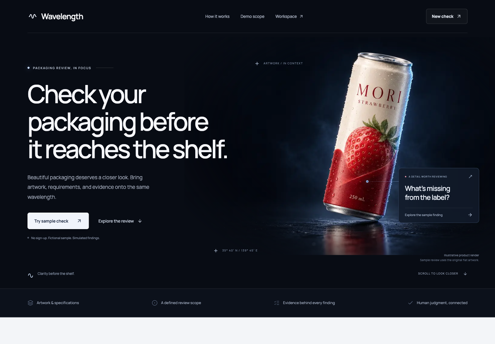
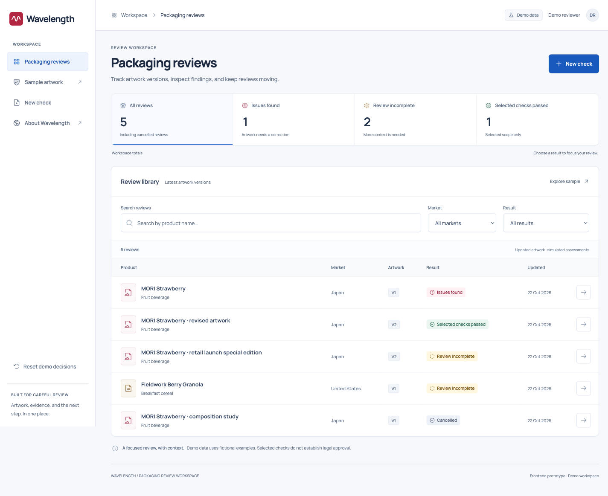
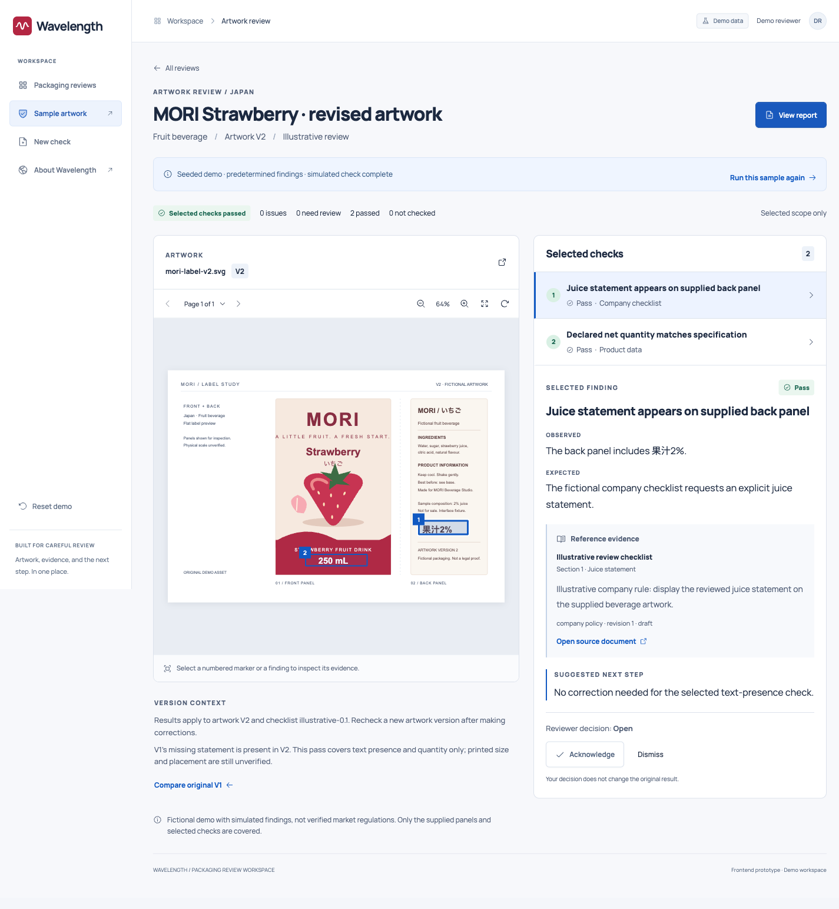
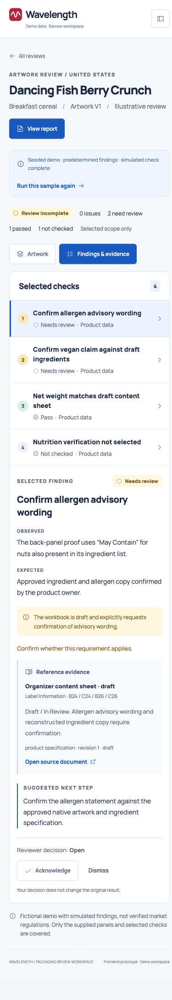
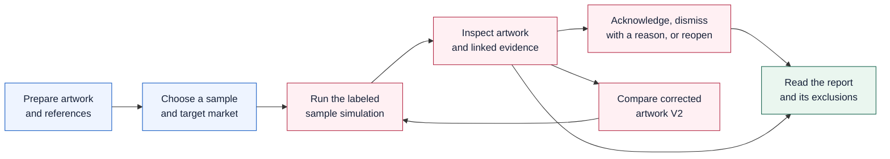
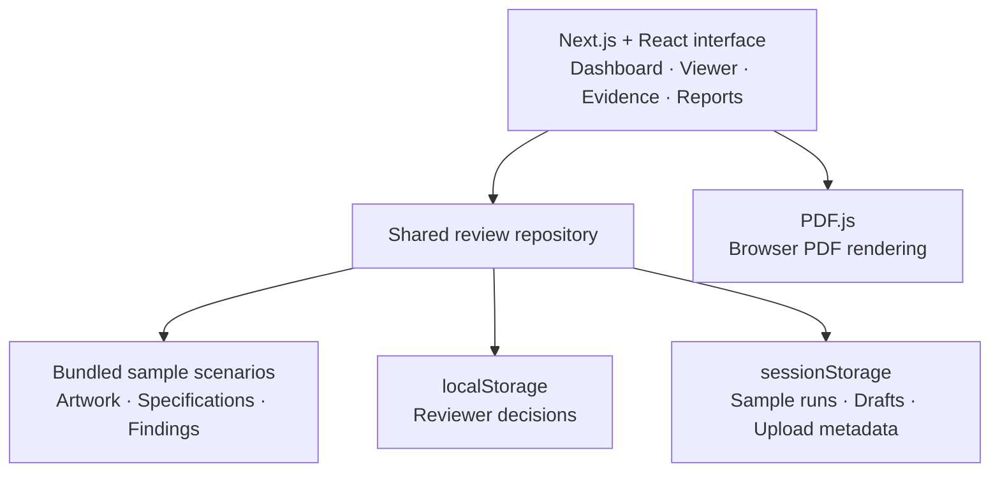

<p align="center">
  
</p>

<h1 align="center">Wavelength</h1>

<p align="center"><strong>Clarity before the shelf.</strong></p>

<p align="center">
  Review packaging before it reaches the shelf.<br>
  Artwork, reference evidence, and reviewer decisions—connected in one workspace.
</p>

<p align="center">
  <a href="https://youtu.be/ASl5XMgqJk4"><strong>Watch the demo ↗</strong></a> ·
  <a href="#a-review-in-practice">Follow a review</a> ·
  <a href="#run-locally">Run locally</a> ·
  <a href="#what-works-today">Explore the scope</a>
</p>

<p align="center">
  
  
  
  
</p>

## Watch it in action

[](https://youtu.be/ASl5XMgqJk4)

**[Watch the 2:17 demo on YouTube →](https://youtu.be/ASl5XMgqJk4)**

See the complete path from a missing statement to corrected artwork, then inspect the organizer's actual carton proof.

| Jump to | What you will see |
| :--- | :--- |
| [0:24 · Prepare a review](https://youtu.be/ASl5XMgqJk4?t=24) | Artwork, market, specification, and reference files. |
| [0:47 · Inspect the evidence](https://youtu.be/ASl5XMgqJk4?t=47) | A finding connected to the artwork, its source, and a correction. |
| [1:25 · Compare corrected V2](https://youtu.be/ASl5XMgqJk4?t=85) | The missing statement is added; selected checks pass. |
| [1:39 · Read the report](https://youtu.be/ASl5XMgqJk4?t=99) | Results, version context, and requirements outside scope. |
| [1:54 · Review organizer material](https://youtu.be/ASl5XMgqJk4?t=114) | Dancing Fish carton proof and draft-source review questions. |

> **Prototype scope:** the review interface is interactive; sample assessments are predetermined. Live OCR, AI inference, and regulatory verification are future work. No account, backend, or AI key is required to try the samples.

## Why we built it

A finished design still has to agree with the product specification, the intended market, and the brand's requirements. A missing statement or an unsupported claim can be easy to overlook when the evidence lives in another document.

Wavelength gives packaging designers, brand teams, and quality reviewers a shared review desk: the artwork on one side, the finding and its evidence on the other. Each concern has a source and a next step; each report says what was actually reviewed.

| Review principle | How it appears in the product |
| :--- | :--- |
| **Evidence before a decision** | Observed/expected values, source excerpts, and reference locations beside the artwork. |
| **Uncertainty stays visible** | Distinct **Pass**, **Fail**, **Needs review**, and **Not checked** results. |
| **Corrections stay traceable** | Reviewer decisions preserve the original result; corrected artwork receives a separate review. |

## A review in practice

Imagine reviewing **MORI Strawberry** for Japan. You have a label, a product specification, and a company checklist. The prepared V1 sample presents three different outcomes:

| Finding | Result | What the reviewer learns |
| :--- | :--- | :--- |
| Juice statement missing from the supplied panels | **Fail** | The fictional company checklist requests a statement that is absent from the supplied artwork. |
| Declared net quantity matches the specification | **Pass** | The label's 250 mL agrees with the sample product specification. |
| Printed type size needs physical scale | **Needs review** | A digital preview cannot establish the actual printed dimensions. |

Select the missing-statement finding. The artwork stays beside the observed value, expected value, reference excerpt, source location, and suggested correction.

**Acknowledge it:** the reviewer decision is saved, and the failed result remains intact.

**Compare corrected V2:** the statement is present, and the selected text and quantity comparisons pass. Printed size, placement, and full market compliance remain unverified.

The distinction matters: resolving a review task and demonstrating that artwork satisfies a requirement are separate actions.

## Inside the workspace

### Every review, in one place

Search by product, filter by market or assessment, and open the relevant artwork version. Status summaries filter the review library itself.



### Artwork beside the evidence

Select a finding to connect its explanation with the relevant page and artwork region. Missing content is tied to the inspected panels. Follow the reference, inspect the suggested next step, and record a decision.


<details>
<summary><strong>See the corrected artwork and mobile organizer review</strong></summary>

#### Corrected MORI V2



#### Dancing Fish on mobile

The organizer's carton proof is compared with its draft content sheet. Unconfirmed allergen wording and a vegan claim remain review questions.



</details>

## How the review works



The report identifies the artwork version, reference revisions, selected checks, reviewer decisions, and requirements outside the review. Acknowledging or dismissing a finding never changes its original assessment.

## What works today

| Interactive today | What you can do |
| :--- | :--- |
| **Find the right review** | Search six baseline examples, filter by market/result, and inspect artwork versions. |
| **Inspect artwork and evidence** | Navigate PDF pages, zoom/rotate, select findings and markers, and open linked references. |
| **Record a review decision** | Acknowledge, dismiss with a reason, or reopen a finding without changing its assessment. |
| **Recheck and hand off** | Run prepared scenarios, compare corrected V2, recover a run after reload, and read scoped reports. |
| **Explore your own files** | Preview PDF, PNG, or JPEG files up to 20 MiB each; uploaded files never inherit sample findings. |

**Still to build:** OCR and semantic extraction, AI inference, live rule evaluation, server-side file storage, and accounts. The progress sequence is explicitly simulated.

### Three runnable scenarios

| Scenario | Material | Review focus |
| :--- | :--- | :--- |
| **MORI Strawberry · V1** | Fictional beverage artwork and sample company documents | Missing statement, matching quantity, uncertain physical measurement. |
| **MORI Strawberry · corrected V2** | Separate corrected artwork | Selected text/quantity checks pass; broader checks remain outside scope. |
| **Dancing Fish Berry Crunch** | Organizer-supplied carton proof and draft/reconstructed workbook | Allergen advisory wording, vegan claim, and quantity comparison with draft-source uncertainty. |

Sample findings demonstrate the workflow. They do not establish legal approval. Source status and interpretation limits are documented in the [reference-data notes](reference-data/README.md).

## Run locally

**Requirements:** Node.js 22.17+ and pnpm 11.25.0.

From the repository root:

```sh
pnpm -C frontend install --frozen-lockfile
pnpm -C frontend dev
```

Open [the landing page](http://127.0.0.1:3000) or [the review workspace](http://127.0.0.1:3000/dashboard).

### Try the complete demo

1. Open **New check → Start with sample files**.
2. Choose **MORI Strawberry** and select **Run simulated check**.
3. Inspect the missing-statement finding, follow its evidence, and acknowledge it.
4. Select **Compare the corrected sample** and run the V2 scenario.
5. Open **View report** to inspect results and exclusions.
6. Try **Dancing Fish Berry Crunch** to review the organizer's supplied material.
7. Use **Reset demo → Reset workspace** to start again.

For a production build:

```sh
pnpm -C frontend build
pnpm -C frontend start
```

Stop the development server before building. After pulling dependency changes, restart development; the `predev` script syncs packages from the committed lockfile.

## How it is built

The screens use a shared repository interface. The current implementation reads bundled sample records and stores demo activity in the browser.



**Frontend:** Next.js 16, React 19, TypeScript, Tailwind CSS 4, shadcn/ui, Phosphor icons, and local Manrope/Noto Sans JP fonts. **Data validation:** Zod. **Checks:** Vitest and Playwright.

Your uploaded file contents are not persisted or uploaded to a server. Re-select your own files after a reload. The default `NEXT_PUBLIC_DATA_MODE=demo` uses the sample workspace; `live` displays an explicit connection error because a live backend is not connected.

<details>
<summary><strong>Development checks and repository map</strong></summary>

```sh
pnpm -C frontend exec tsx scripts/validate-sources.ts
pnpm -C frontend exec tsx scripts/validate-demo.ts
pnpm -C frontend typecheck
pnpm -C frontend lint
pnpm -C frontend test:unit
pnpm -C frontend exec playwright install chromium
pnpm -C frontend test:e2e
```

For browser checks against a production build, use `PLAYWRIGHT_PRODUCTION=1`; use `PLAYWRIGHT_CHANNEL=chrome` to select an installed Chrome browser. See the [frontend README](frontend/README.md) for environment and storage details.

| Path | Purpose |
| :--- | :--- |
| [`frontend/src/app/`](frontend/src/app/) | Landing, dashboard, setup, artwork review, and report routes. |
| [`frontend/src/components/`](frontend/src/components/) | Shared interface, document viewer, findings, and evidence panels. |
| [`frontend/src/data/`](frontend/src/data/) | Repository interface selection and sample implementation. |
| [`frontend/src/demo/`](frontend/src/demo/) | Scenario definitions, fixtures, and asset hashes. |
| [`frontend/public/demo/`](frontend/public/demo/) | Bundled artwork and reference documents. |
| [`reference-data/`](reference-data/) | Source provenance, rule assumptions, and expected sample results. |
| [`frontend/tests/`](frontend/tests/) | Unit and browser checks. |
| [`demo-output/`](demo-output/) | Editable video script, capture workflow, and rendering pipeline. |

</details>

## What comes next

The product vision is AI-assisted packaging review across market requirements, product accuracy, and brand guidelines. The next step is to connect the working review experience to dependable extraction and traceable checks.

| Current boundary | Next step |
| :--- | :--- |
| Prepared sample assessments | Extract inspectable text and structure from real artwork and specifications. |
| Bundled references and limited sample comparisons | Evaluate a small supported rule set against versioned, traceable sources. |
| Local browser activity | Add a backend for files, review versions, jobs, and persisted decisions. |
| Digital previews with uncertain physical scale | Establish trustworthy dimensions before evaluating printed-size requirements. |

The review should always show when a source is draft, a requirement is uncertain, or a check was left out.

---

<p align="center"><strong>Connect the artwork. Inspect the evidence. Make the next decision clear.</strong></p>
<p align="center"><a href="https://youtu.be/ASl5XMgqJk4">Watch the demo</a> · <a href="#run-locally">Try the samples</a> · <a href="reference-data/README.md">Read the source notes</a></p>
