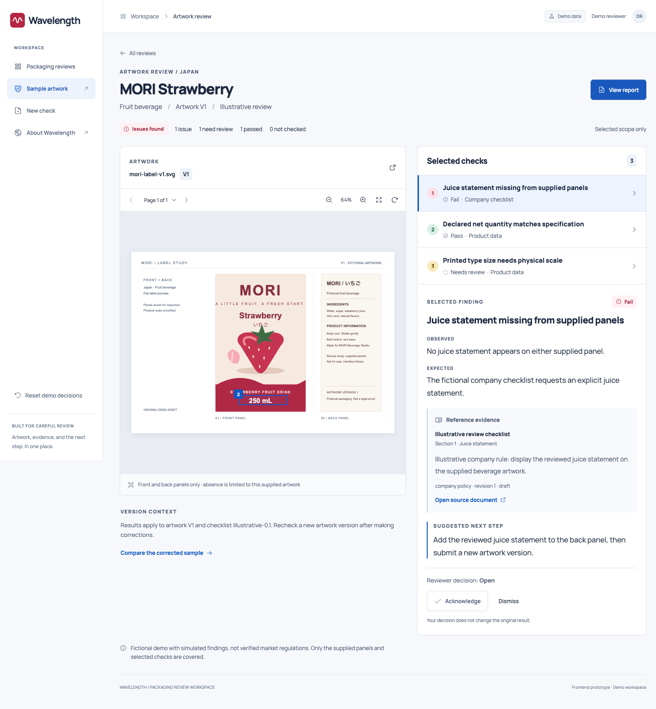
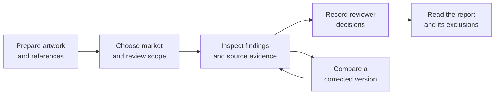

# Wavelength

**Clarity before the shelf.**

Wavelength is a packaging compliance review workspace. It connects artwork, product specifications, and reference evidence so teams can see what needs attention, understand why it was flagged, and plan corrections before launch.

Built for packaging designers, brand teams, and the people responsible for quality and compliance.

**Current release:** an interactive product prototype with prepared sample files and simulated assessments.

[The workflow](#how-the-review-works) · [Explore the samples](#a-concrete-look-at-the-product) · [Run locally](#explore-the-prototype)

## A small detail can hold up a big launch

A missing statement. A quantity that disagrees with the specification. A claim whose supporting document is still a draft.

Packaging teams need to catch these details while working across artwork files, product sheets, market requirements, and company guidelines. When those inputs are scattered, each concern creates more work: locate the relevant panel, find the right reference, explain the discrepancy, and make sure the correction reaches the next version.

Wavelength is built around that moment between a finished design and a confident launch decision. The goal is to surface concerns earlier and give reviewers enough context to act on them.

## From a flagged detail to an informed decision

An effective review needs a clear chain of evidence. Wavelength keeps that chain beside the artwork.

| The reviewer's question | What the workspace brings into view |
|---|---|
| **What needs attention?** | A finding with a distinct result: pass, fail, needs review, or not checked. |
| **Where should I look?** | The relevant artwork page and highlighted region, or the inspected panels when text is missing. |
| **What is the comparison based on?** | Observed and expected values, a reference excerpt, and its source location. |
| **What should happen next?** | A suggested correction and a place to acknowledge, dismiss with a reason, or reopen the finding. |
| **What does this review actually cover?** | A report that preserves results, decisions, and requirements outside the selected scope. |

Selecting a finding connects the artwork and its explanation. Reviewers can follow the source, record their judgment, and compare a corrected sample without losing sight of the original assessment.

<details>
<summary><strong>See the artwork review workspace</strong></summary>



*The illustrated MORI scenario uses fictional packaging and simulated findings.*

</details>

## How the review works

The frontend demonstrates this journey through prepared sample scenarios. Uploaded files outside those scenarios can be previewed locally.



Artwork versions and reviewer decisions serve different purposes. Acknowledging or dismissing a finding keeps its original result intact. Corrected artwork receives a separate review, so a decision about an issue cannot silently turn it into a passed check.

## A concrete look at the product

The demo makes room for an issue, a correction, and a question that still needs human judgment.

| Sample | What it demonstrates |
|---|---|
| **MORI Strawberry · V1** | A missing juice statement against a fictional company checklist, a matching quantity, and a question about printed type size that needs physical measurements. |
| **MORI Strawberry · corrected V2** | The statement has been added and the selected text and quantity comparisons pass. Physical size, placement, and broader regulatory requirements remain outside that passed scope. |
| **Dancing Fish Berry Crunch** | The organizer's carton proof and draft content sheet anchor the review in supplied documents. Unconfirmed allergen wording and a vegan claim remain review questions. |

The dashboard brings these reviews together with search, market and result filters, artwork versions, and clear status labels. The viewer supports images and PDFs; the report carries the review's evidence and boundaries forward.

**Prepared scenarios produce predetermined findings.** The current MVP does not perform OCR, AI inference, or live regulatory verification on uploaded files. A selected set of passed checks does not establish legal approval.

## The vision: a clearer path from artwork to launch

Our ambition is to use AI to read packaging inputs, compare them with reliable requirements, and give teams evidence they can inspect before making a launch decision.

That vision connects three kinds of review:

- **Market requirements:** labeling and packaging obligations in each target market, tied to identifiable sources and their applicable versions.
- **Product accuracy:** quantities, composition, and claims compared with the product's approved specifications.
- **Brand consistency:** required statements, approved copy, and design standards compared with company guidelines.

Getting there requires dependable document reading and a carefully maintained body of reference material. When information is incomplete, a source is unapproved, or a measurement cannot be established, the product should make that uncertainty visible.

The frontend puts this principle into practice: every finding has context, every decision leaves the assessment intact, and every report makes its limits clear. Live extraction and verification are the next stage of the product.

## Explore the prototype

Open **New check → Start with sample files**, choose MORI V1, corrected V2, or Dancing Fish, and select **Run simulated check**. Follow a finding to its evidence, record a decision, and open the report. **Reset demo → Reset workspace** restores the starting examples.

No account or AI key is needed to explore the prepared samples. Product imagery and sample files are bundled with the frontend.

<details>
<summary><strong>Frontend and local setup</strong></summary>

The interface uses **Next.js, React, and TypeScript**, with **Tailwind CSS and shadcn/ui** for the frontend. The current experience runs with local demo data.

With Node.js 22.17+ and pnpm 11.25.0 installed, run from the repository root:

```sh
pnpm -C frontend install --frozen-lockfile
pnpm -C frontend dev
```

Open [the landing page](http://127.0.0.1:3000) or [the review workspace](http://127.0.0.1:3000/dashboard). Restart the development server after pulling dependency changes.

See the [frontend README](frontend/README.md) for configuration and development details.

</details>

[Demo walkthrough and capability boundaries](docs/submission/DEMO.md) · [Sample sources and provenance](reference-data/README.md)
