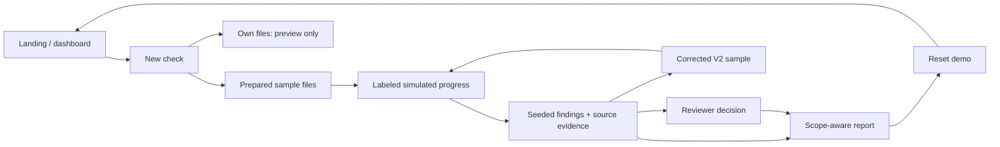

# Wavelength seeded demo

## Recording script (about 4 minutes)

Before recording, open the production build at 1440px, choose **Reset demo → Reset workspace**, and confirm six baseline reviews. Use one browser session throughout. Close unrelated tabs. No account, AI key or backend is required.

| Time | Screen and action | Suggested narration |
|---|---|---|
| 0:00–0:25 | Landing: hero and interactive sample | “Wavelength connects packaging artwork, requirements, evidence and a reviewer’s next step. Today’s demonstration uses fixed sample findings.” |
| 0:25–0:55 | Workspace → New check → Start with sample files | “The product, market, artwork and references are prepared. We can use our own files for a preview, or run these repeatable sample scenarios.” |
| 0:55–1:15 | MORI V1 → Run simulated check | “This short sequence is simulated. It prepares predetermined findings; it is not running OCR or AI.” |
| 1:15–2:00 | Open missing-statement finding, then quantity and physical-size findings | “The supplied panels lack the selected company-policy statement. Quantity matches the sample specification. Printed type size stays uncertain because the digital artwork has no verified physical scale.” Show the source document and its research-background link. |
| 2:00–2:20 | Acknowledge a finding; reload | “Reviewer decisions are saved in this browser. Acknowledging a finding does not change its result.” |
| 2:20–2:55 | Compare corrected sample → Run simulated check → View report | “V2 includes the selected statement. Its text and quantity checks pass. This is a narrower selected scope: physical size, placement and full regulatory approval remain unverified.” Show original V1 link and report exclusions. |
| 2:55–3:40 | New check → Start with sample files → Dancing Fish → Run | “This second sample uses the organizer’s actual carton and workbook. The content sheet is draft and reconstructed, so allergen wording and the vegan claim become review questions, not confirmed legal failures.” Open cell-linked source notes; show original workbook download. |
| 3:40–4:00 | Report, then Reset demo | “The report preserves evidence, decisions and boundaries. Reset returns the demonstration to its initial state. Live extraction and verification are future work.” |

## Capability boundary

| Implemented and interactive | Seeded/simulated | Not implemented |
|---|---|---|
| Dashboard search/filter, image/PDF viewer, zoom/page/rotation, source navigation | Finding text, markers and result classifications | OCR or semantic file extraction |
| Sample setup, cancellation, distinct run IDs, reload recovery | Short reading/comparing/preparing sequence | AI inference or live legal rule evaluation |
| Reviewer decisions, required dismissal reason, reports, corrected-sample navigation | MORI V1/V2 scenarios; organizer review questions | Backend, database, accounts, server file storage |
| Own-file local previews with type/size validation | Fixed sample product/reference inputs | Findings for arbitrary uploads |

Only explicitly selected seeded scenarios can generate sample reports. Filename, product name, or a similar uploaded image does not unlock sample findings. Session storage retains at most 20 sample runs; decisions are local to the browser. Reset clears started runs, decisions, local upload metadata and draft name. The immutable examples remain.

## Sources and known limits

- `reference-data/sources.json`: actual retrieval date, source location, language, interpretation status, reuse notes and artifact hashes.
- Organizer carton: one-page US dieline proof. Workbook: draft/reconstructed. No certification or legal approval inferred.
- CAA FAQ Q34–35, notice and implementation standard were inspected through the web reader. Direct binary downloads failed DNS resolution; source-note artifacts and external links are retained, not falsely labeled archived originals.
- English CAA interpretation is not qualified-reviewed. MORI’s missing-text finding remains a fictional company-policy comparison. Corrected V2 passes only selected text/quantity checks.
- `reference-data/rules.json` records additional boundary examples (unknown composition, exactly 5%, front-only panels, quantity mismatch). They are documented cases, not extra runnable UI scenarios or a live rule engine.
- Original Fieldwork fixtures remain as a clearly fictional multipage PDF example; the separate Dancing Fish scenario is the actual organizer material.

## Flow



## Rehearsal checks

Run from the repository root:

```sh
pnpm -C frontend install --frozen-lockfile
pnpm -C frontend exec tsx scripts/validate-sources.ts
pnpm -C frontend exec tsx scripts/validate-demo.ts
pnpm -C frontend typecheck
pnpm -C frontend lint
pnpm -C frontend test:unit
pnpm -C frontend build
PLAYWRIGHT_PRODUCTION=1 PLAYWRIGHT_CHANNEL=chrome pnpm -C frontend exec playwright test tests/e2e/demo.spec.ts
```

Stop an existing development server before building. Record actual command results in PROGRESS.md. Do not present this as deployed until the public deployment has been updated and checked separately.
