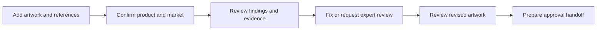

# Veriforge

## From Packaging Artwork to Launch Readiness

**Product vision and idea · Esko AIForge · 22 October 2026**

**Selected challenge:** Is this Packaging Artwork Ready to Launch?

**Current priority:** Communicate a compelling product idea, demonstrate its core workflow through a clean frontend dashboard, and complete the submission. Backend design and technical architecture belong in a later discussion.

## 1. The idea in one minute

A packaging design can look finished while still containing information that needs correction. The person responsible for moving it forward must reconcile the artwork, approved product information, company requirements, and relevant labeling rules before deciding what happens next.

**Veriforge is an AI-assisted packaging review workspace that turns scattered requirements into a clear, evidence-backed path to approval.**

A user brings together the artwork, product context, and supporting documents. Veriforge is intended to identify potential inconsistencies, show where they appear, explain the supporting requirement, and recommend the next action. The team can then separate clear corrections from questions requiring an expert and track the revised artwork through review.

The product should answer three questions immediately:

1. **What is blocking this artwork from moving forward?**
2. **What evidence supports each finding?**
3. **What should we fix, clarify, or send for human review?**

The promise is clearer decisions and fewer avoidable review loops. Final approval remains with the responsible people.

## 2. Our vision

> Give packaging teams the clarity to move every artwork from uncertainty to a confident, accountable approval decision.

We want designers to understand exactly what needs changing, reviewers to spend their attention on meaningful judgment, and launch owners to see what still stands between an artwork and approval.

This vision balances ambition with a credible starting point: help one team review one artwork against a known set of requirements, then expand from there. It reflects three product values: **clarity, evidence, and human accountability**. It also aligns with the challenge’s focus on reliable review and Esko’s stated ambition to help brands bring higher-quality products to market.

### Vision options considered

| Option | Emphasis |
|---|---|
| Give packaging teams the clarity to move every artwork from uncertainty to a confident, accountable approval decision. | Selected: combines an emotional outcome with a concrete workflow. |
| Make every packaging review easier to understand, act on, and trust. | Memorable and practical, but less explicit about the destination. |
| Help teams catch packaging mistakes before they become launch problems. | Strong expression of the pain, but narrower than the long-term vision. |

## 3. The problem worth solving

**The central problem is uncertainty at the point of artwork approval.**

The hackathon brief describes information spread across documents, spreadsheets, artwork files, websites, and conversations. Our product hypothesis is that this fragmentation creates three connected burdens:

- **Finding the right reference:** Which product information and rules apply to this artwork and market?
- **Understanding the discrepancy:** What differs, where is it, and does the evidence justify a correction?
- **Coordinating the response:** Who needs to act, and has the revised artwork actually resolved the issue?

A vague comment such as “check the quantity” leaves the designer with another investigation. A useful finding shows the artwork value, the approved value, the source, and the next step together.

Potential consequences include revision cycles, delayed approvals, and errors reaching production. We have not yet measured their frequency, cost, or severity with customers; these are discovery hypotheses, not quantified benefits.

## 4. Who we serve first

Our first segment is **teams reviewing food packaging against an approved content sheet and a defined set of supplied requirements**. This gives us a concrete review task with references people can inspect.

The primary user is the packaging reviewer or coordinator responsible for assembling feedback and moving the artwork toward approval. Designers and regulatory or quality reviewers participate in the same workflow.

| User need | Job to be done | Current alternative | Value Veriforge aims to deliver |
|---|---|---|---|
| Review and coordinate an artwork | “Help me identify unresolved issues and prepare a defensible review.” | Read documents, compare values, consolidate comments in a spreadsheet or review tool. | One prioritized view of findings, references, and outstanding decisions. |
| Correct the artwork | “Help me understand exactly what to change and why.” | Interpret email threads, PDF annotations, and disconnected comments. | Specific feedback linked to the affected artwork and expected content. |
| Resolve specialist questions | “Help me focus on the decisions that require my expertise.” | Recheck routine details alongside ambiguous claims and rules. | A focused review queue that preserves uncertainty and supporting evidence. |

**First buyer hypothesis:** A packaging operations or quality lead who owns review throughput and consistency. Buyer identity and willingness to pay still need validation.

For the hackathon, use the organizer-provided US granola artwork and matching content sheet as the starting scenario. Keep requirements aligned with that market. The original India food-labeling direction remains a future expansion or a separate scenario once matching artwork and references are available.

## 5. The product experience

The experience should feel like a focused review desk. The artwork and the decision belong at the center of the screen.

### Step 1: Start a review

The user adds artwork, an approved content sheet, and any relevant rulebook or company guidelines. They confirm the product, intended market, artwork version, and which references are authoritative.

If essential information is missing or references conflict, the product asks a focused question. It keeps the gap visible until someone resolves it.

### Step 2: Understand the review scope

Before showing results, the workspace states what it is checking and which references it is using. Product-data checks, supplied regulatory requirements, and company policies appear as distinct categories.

This prevents a review against a small rule set from implying complete compliance coverage.

### Step 3: See what needs attention

The review opens with the most consequential unresolved issues. Selecting a finding connects three things in one view: the artwork location, the expected information, and its supporting source.

A finding explains:

- What was observed and what was expected.
- Where the relevant information appears, or which panels were inspected for missing content.
- Which document and section support the finding.
- Why it matters and what action is recommended.
- Whether the issue is established by the supplied evidence or needs a person to decide.

### Step 4: Act on the finding

The user can request a correction, send a question for specialist review, or dismiss a finding with a reason. A reviewer can record a decision and its rationale. These actions remain visible in the review history.

### Step 5: Check the revision and prepare the handoff

The user adds a revised artwork and sees which previous issues are resolved, still open, or require fresh review. An issue is only marked resolved when the revision and supporting evidence justify that status.

The final handoff summarizes the artwork version, reviewed scope, outstanding exceptions, and human decisions. A new artwork version requires review before it inherits approval.

## 6. The dashboard we should demonstrate

Build one coherent journey through four focused views. A reviewer should understand the product without needing a narrated tour of every control.

| View | Main user question | Essential content |
|---|---|---|
| Review overview | “What needs my attention?” | Artwork cards with product, market, version, review status, and unresolved issue counts. |
| New review | “What are we checking?” | Artwork and reference inputs, confirmed context, missing-information prompts, and a sample-review shortcut. |
| Artwork review workspace | “What is wrong, and why?” | Large artwork preview, numbered finding markers, prioritized findings, source evidence, and next actions. |
| Review summary | “What can move forward?” | Resolved and open issues, expert decisions still needed, scope, and approval-handoff summary. |

**The signature interaction:** Click a quantity discrepancy and immediately see the affected artwork region beside the approved value and source reference. The user can understand and act without searching through separate files.

The interface should prioritize readable artwork, plain language, and consistent status labels. Use restrained color and pair it with text or icons. Every prominent control in the demonstrated path should produce a meaningful result.

### Statuses that communicate honestly

| Level | Status | Meaning |
|---|---|---|
| Individual check | Matches reference | The inspected element agrees with the cited requirement. |
| Individual check | Issue found | The supplied evidence establishes a discrepancy. |
| Individual check | Needs human review | Interpretation, unclear content, or conflicting references prevent a firm conclusion. |
| Coverage | Not checked | This requirement or part of the artwork has not been assessed. |
| Overall review | Changes required | Confirmed issues remain unresolved. |
| Overall review | Review incomplete | Required checks or human decisions remain open. |
| Overall review | Ready for approval | The defined review is complete and ready for the designated approver. |

“Ready for approval” applies only to the stated scope and artwork version. It is distinct from a recorded human approval. Avoid a percentage compliance score that could hide an important unresolved issue.

## 7. One compelling demo story

**Scenario:** A packaging coordinator receives a food-carton design and needs to prepare it for approval.

The following findings are illustrative fixtures, not verified defects in the organizer’s sample files and not statements of law.

| Illustrative finding | Evidence shown in the demo | User action |
|---|---|---|
| Artwork says 200 g; approved product sheet says 250 g. | Artwork region beside the relevant product-sheet entry. | Request a correction. |
| A statement required by the supplied company rulebook is absent. | Rulebook requirement beside the inspected artwork panels. | Request the statement be added. |
| A marketing claim has no supporting document in the review. | Claim location and an explicit missing-evidence message. | Ask a specialist to verify; avoid declaring the claim unlawful. |
| Product name agrees with the approved sheet. | Matching values and source reference. | Confirm the check needs no action. |

For the recording, use findings grounded in the actual sample files, or visibly label an intentionally modified demonstration copy. Do not attribute invented errors to the original artwork.

The story takes the viewer from an initial “Changes required” state to a revised artwork with corrections resolved and one specialist decision still open. The final screen explains exactly what remains before approval.

**The memorable moment:** The team moves from “something may be wrong” to “we know what to change and who must decide.”

## 8. Why this product is valuable

Veriforge brings the observation, requirement, evidence, and action together at the point of review. Its proposed differentiation is the completeness of that decision experience:

- **Context:** Findings relate to a specified product, market, artwork version, and reference set.
- **Traceability:** People can inspect the basis for a finding and challenge it.
- **Actionability:** Feedback explains the correction or decision needed.
- **Continuity:** Review history connects an issue with the revised artwork and its disposition.

AI’s intended role is to help interpret varied references, relate them to artwork, surface discrepancies, and explain uncertainty in useful language. The interface should make that assistance easy to inspect and correct.

This is a positioning hypothesis. We have not completed a competitive assessment and should not claim these capabilities are unique or absent from existing Esko products. Longer term, Veriforge could complement established artwork review workflows; no integration or partnership is assumed.

## 9. Strategy and deliberate focus

The strategy is to win a narrow review task through useful evidence and clear next actions, then earn the right to cover more packaging scenarios.

| Strategy decision | Direction |
|---|---|
| Vision | Make packaging approval decisions clearer and accountable. |
| First segment | Food-packaging teams working with approved content and supplied requirements. |
| Cost and value position | Prioritize dependable review value over competing on the cheapest scan. Relative costs and pricing are unvalidated. |
| Value proposition | Turn fragmented references and comments into an actionable review with visible evidence. |
| Trade-offs | Complete one artwork-review journey before adding countries, categories, or broad automation. |
| Metrics | Measure completed review decisions, comprehension, evidence quality, and review effort. |
| Growth hypothesis | Begin with assisted pilots for packaging or quality leads; expand within teams after demonstrating repeat value. |
| Required capabilities | Packaging-domain input, usable evidence presentation, consistent review decisions, and customer discovery. Seek expert input for rule interpretation. |
| Potential defensibility | Trusted review history and reusable company-specific requirements could become valuable over time. No moat is established today. |

The likely commercial direction is a team subscription, potentially shaped by review volume. Pricing and unit economics should follow evidence about customer value and the cost of delivering dependable reviews.

### Hackathon scope

Prioritize one sample product, one market, a small reference set, and a complete review journey. The frontend should demonstrate opening findings, inspecting evidence, taking a review action, and seeing a clear summary.

Defer worldwide regulatory discovery, automatic artwork editing, production release, enterprise integrations, and extensive portfolio analytics. These would dilute the core story before we have demonstrated its value.

A guided frontend prototype can communicate this product vision. Any pre-authored findings, simulated analysis, or revision transitions must be labeled as demonstration behavior. Only implemented capabilities should be described as working AI functionality.

## 10. What success means

**For this submission:** A viewer can follow the core workflow, understand a finding and its evidence, and explain what remains before approval within a short demo.

**Proposed North Star:** Weekly artwork reviews reaching a documented human decision, with review scope and unresolved exceptions visible. A decision can be approval, requested changes, or escalation; the metric should reward useful review rather than rubber-stamping.

**First validation metric:** The proportion of first-time target users who can correctly identify the main issue, explain its evidence, and choose the next action without facilitator help.

Supporting measures should include time to understand a finding, expert agreement with findings, unsupported findings, missed known issues, and reviewer effort compared with the current process. No performance results or customer savings are claimed yet.

## 11. Assumptions to test after submission

| Hypothesis | Low-effort experiment | What would challenge it? |
|---|---|---|
| Connecting artwork and source evidence reduces review effort. | Ask several packaging reviewers to assess the same example with their current approach and the prototype. | They still need to repeat the full investigation to trust each finding. |
| The proposed review states are understandable. | Give users a mix of confirmed issues, uncertain findings, and unchecked requirements; ask what can move forward. | Users mistake incomplete review for approval. |
| Designers can act on the feedback. | Give a designer a finding without verbal explanation and ask them to describe the intended correction. | They cannot locate the issue or understand the expected content. |
| Teams can supply authoritative references. | Walk through a recent review and ask which documents were considered final. | References are unavailable, contradictory, or routinely outdated. |
| A lead will adopt a focused review workspace. | Discuss a recent approval delay, existing tools, and conditions for a small pilot. | The workflow adds coordination effort without replacing meaningful work. |

These tests should shape the next iteration. They are not prerequisites for finishing the concept document or frontend demonstration.

## 12. Where the vision can grow

**Now:** Make one review understandable and actionable.

**Next:** Support repeated reviews, artwork revisions, reusable company requirements, and team handoffs.

**Later:** Help teams assess market variants, understand which artworks may be affected by changing requirements, and connect review evidence with existing artwork management workflows.

The enduring product question is: **“Can this artwork move forward, and what evidence supports that decision?”**

## 13. Submission pitch and brief alignment

### Ready-to-use product pitch

Veriforge helps packaging teams understand what stands between finished artwork and approval. It brings artwork, approved product information, and supplied requirements into one review workspace. Users can see potential issues on the artwork, inspect the evidence, and decide whether to request a correction or involve a specialist. The proposed experience carries those findings through revision to a clear approval handoff. Our hackathon focus is a simple dashboard demonstrating that journey for one food-packaging scenario. The ambition is to make packaging review easier to understand, act on, and trust.

### What the brief means for this concept

The [official Esko AIForge brief](https://www.hackerearth.com/community/challenges/hackathon/esko-aiforge/) asks for an artwork checker with explanations, evidence, and a distinction between problems and cases needing human review. It favors an intuitive working prototype and thoughtful handling of uncertainty. This concept centers those outcomes.

The submission also calls for a flow or architecture diagram, a description of the technologies actually used, a 3–5 minute recording with sample files, and source code. This document supplies the product direction and workflow; it does not establish that those deliverables or live AI verification are complete. Implementation details can be documented separately once built.

**Source basis:** The official challenge page, retrieved on 22 October 2026; the local brief at `/Users/sourabhkapure/Downloads/Esko AIForge.md`; and the supplied Veriforge proposal. Customer needs, commercial choices, and benefits beyond the brief are explicitly proposed hypotheses.
